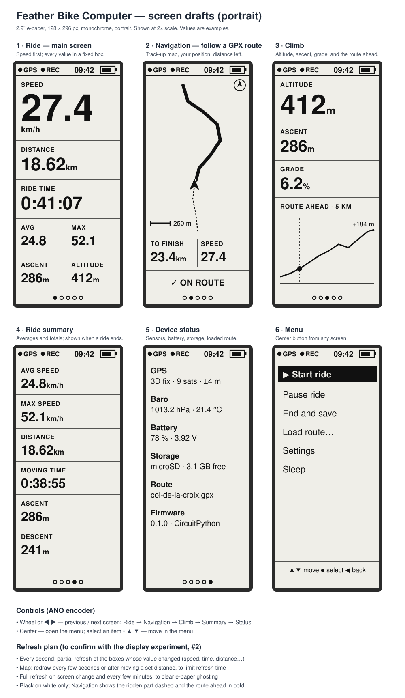

# Screens

Screen designs for the 2.9" e-paper display. These are drafts: layouts and
fields will be refined as the firmware is built and tested on the device.

- **Display:** 128 × 296 pixels, portrait orientation.
- **Colors:** black on white only, so the display's monochrome refresh modes
  can be used.
- **Units:** km/h and meters.

The drawing's source is [images/ui-screens.svg](images/ui-screens.svg), a
hand-written SVG file shown at 2× scale; values in it are examples.

## Common elements

- **Status bar** (top of every screen): GPS fix, recording indicator, clock,
  and battery level.
- **Page dots** (bottom of the main screens): which of the five screens is
  shown.
- **Fixed boxes:** each value has its own box, separated by lines, so a value
  can be redrawn without redrawing the rest of the screen.

## Screens

| # | Screen | Content |
| --- | --- | --- |
| 1 | **Ride** (main screen) | Speed (large), distance, ride time, average and max speed, ascent, altitude |
| 2 | **Navigation** | Map of the loaded GPX route, rotated to the direction of travel (track-up): ridden part dashed, route ahead in bold, position arrow, scale bar, north indicator. Distance to finish, speed, and on-route / off-route indicator |
| 3 | **Climb** | Barometric altitude, total ascent, current grade, and the elevation profile of the next 5 km of the route with the current position |
| 4 | **Ride summary** | Average and max speed, distance, moving time, ascent, descent; also shown when a ride ends |
| 5 | **Device status** | GPS fix and satellites, pressure and temperature, battery, microSD space, loaded route, firmware version |
| 6 | **Menu** | Start ride, pause ride, end and save, load route (pick a GPX file from the microSD card), settings, sleep |

## Controls (ANO encoder)

| Input | Action |
| --- | --- |
| Wheel, or ◀ ▶ | Previous / next screen: Ride → Navigation → Climb → Summary → Status |
| Center | Open the menu; select an item |
| ▲ ▼ | Move in the menu |
| ◀ (in the menu) | Back |

## Refresh plan

Target: values update every second. This depends on partial refresh, which the
display experiment ([#2](https://github.com/spech/feather-bike-computer/issues/2))
must confirm.

- **Every second:** partial refresh of only the boxes whose value changed.
- **Map:** redrawn every few seconds, or after moving a set distance, because
  redrawing the whole map takes longer than updating a number.
- **Full refresh:** on each screen change and every few minutes, to clear the
  ghost images e-paper leaves behind.

If partial refresh is not available in CircuitPython, the layouts stay the same
but values update less often until the Rust firmware.

## Later

- Additional fields, such as heart rate or cadence from Bluetooth sensors.
- Turn-by-turn prompts on the Navigation screen.
